# How to Integrate an AI Assistant into an SAP Transaction Using ABAP AI tools

<p>
  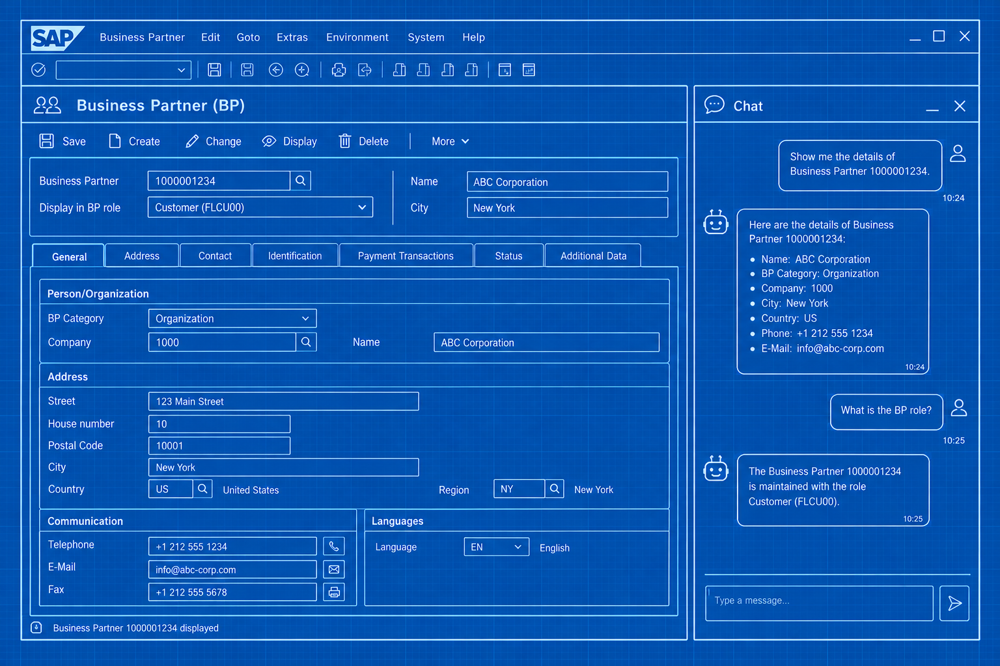
</p>

In this how-to guide, we will walk through a step-by-step implementation of an AI Assistant in the BP transaction using ABAP AI tools, along with the building blocks required for this integration.

We will use the BP transaction because it is available in SAP ABAP trial systems. This makes the example useful for ABAP developers who use trial systems to learn and experiment.

## General Technical Prerequisites

As with any custom development within a standard SAP transaction, integrating an AI Assistant requires an appropriate enhancement or extension mechanism, such as a BAdI, a user exit, or another supported enhancement option.

Ideally, users should be able to open the AI Assistant on demand. To achieve this, the SAP transaction must provide a way to customize its user interface, allowing us to add an entry point for the Assistant. This could be a menu option, a screen element, or another interactive UI component, depending on the extension options available in the transaction.

Some SAP transactions provide specific mechanisms for customizing or extending their user interfaces. The BP transaction is a good example, as it uses the Business Data Toolset (BDT), a central framework for configuring and extending Business Partner (BP) maintenance screens, dialog programs, and transactions without modifying standard SAP source code.

Other standard transactions may not provide a supported way to add custom menus or screen elements. In such cases, it may still be possible to open the AI Assistant automatically when the transaction starts. To achieve this, we need to identify an appropriate enhancement option, such as a BAdI or user exit, that is triggered at a suitable point during the transaction's execution and allows the Assistant to be launched.

The key takeaway is that we need to analyze each standard transaction to determine the available options for integrating the AI Assistant, whether through a user interface enhancement or an alternative mechanism.

## ABAP AI tools Prerequisites

This example requires both `ABAP AI tools` and `ABAP AI tools User Interface` to be installed on your system.

For the `ABAP AI tools` installation, see: https://github.com/christianjianelli/yaai

For the `ABAP AI tools User Interface` installation, see: https://github.com/christianjianelli/yaai_ui

## The Business Partner AI Assistant

For the AI Assistant's user interface, we will use the `ABAP AI tools User Interface` to provide the chat interface through which users can interact with the Assistant.

To implement the AI Assistant itself, we will use `ABAP AI tools`, providing system instructions and tools.

## Extending the Business Partner Transaction

For this example, we are going to configure a custom event that will be available in the **Extras → More Extras** menu in the **BP** transaction. We will use this custom event to provide users with a way to open the AI Assistant chat.

The steps are as follows:

**1.** Create a function group, for example, `ZFG_AAI_BP`.

**2.** In this function group, create a function module with the same parameters as the standard function module `BUA_BUPA_EVENT_FCODE`. For example, `Z_F_EVENT_FCODE_YAAI`. The function code `YAAI` will be used to instantiate the AI Assistant chat.

```abap
FUNCTION Z_F_EVENT_FCODE_YAAI
  IMPORTING
    VALUE(I_FCODE) LIKE TBZ4-FCODE OPTIONAL
    VALUE(I_CRSFIELD) LIKE BUS000TBFL-TBFLD OPTIONAL
    VALUE(I_CRSLINE) LIKE SY-LILLI OPTIONAL
  EXPORTING
    VALUE(E_XHANDLE) TYPE C.


  e_xhandle = 'X'.

  IF i_fcode <> 'YAAI'.

    CLEAR e_xhandle.

    RETURN.

  ENDIF.

ENDFUNCTION.
```

**3.** Open transaction **BUS9** and choose `New Entries` to create a new function code. Set the function code to `YAAI` and enter `AI Assistant` as the function text.

Keep the `Active by Activity, View, and Sequence Category` option selected, and enter `4` (Extras) in the `Menu` field. Select all checkboxes under `Save Mode` and `Transfer Mode`.

Next, double-click `Active In Each View` on the left, choose `New Entries`, leave the `View` field empty, and select all checkboxes under `Save Mode` and `Transfer Mode`.

Then, double-click `Active In Each View/Screen Sequence Category`, choose `New Entries`, leave the `View` and `Screen Sequence Category` fields empty, and select all checkboxes under `Save Mode` and `Transfer Mode`.

<p>
  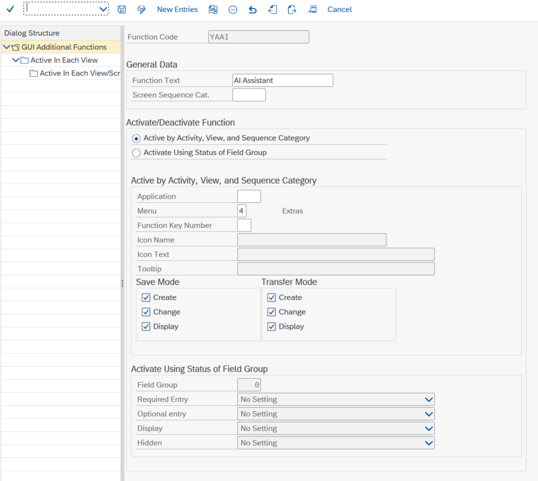
</p>

<p>
  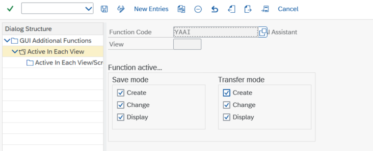
</p>

<p>
  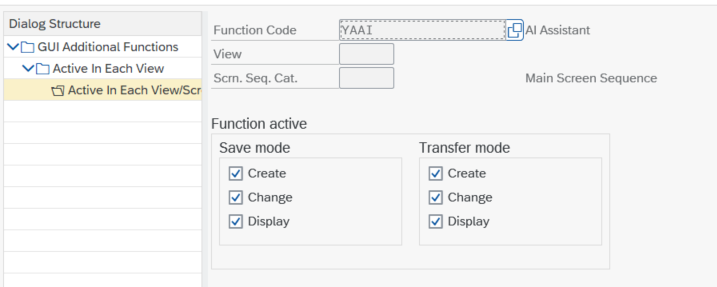
</p>

**4.** Open transaction **BUS7**, select the `FCODE` entry, and then double-click `Event → Function Modules`. Choose `New Entries` and enter `9000001` in the `Item` field. Enter the name of the function module you created, `Z_F_EVENT_FCODE_YAAI`, select `X` in the `Call` field, and enter `BUP` in the `Application` field.

<p>
  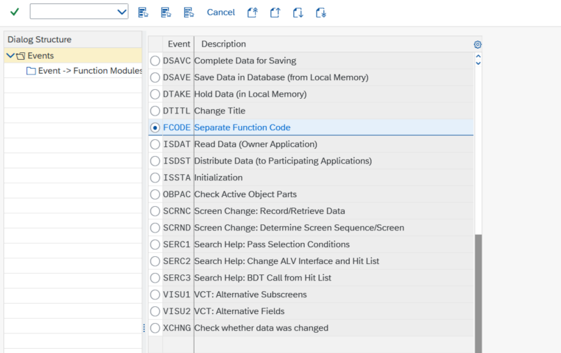
</p>

<p>
  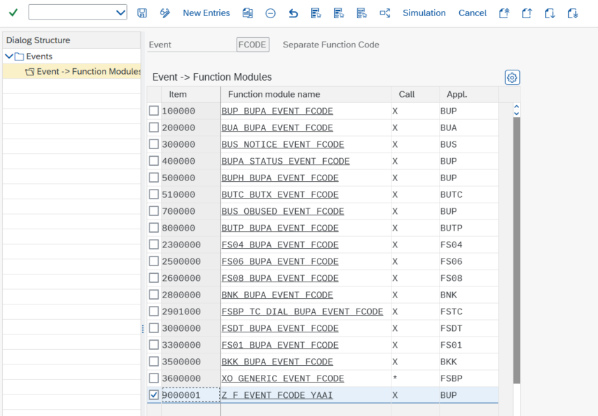
</p>

After completing these steps, you should see `AI Assistant` in the **Extras → More Extras** menu.

<p>
  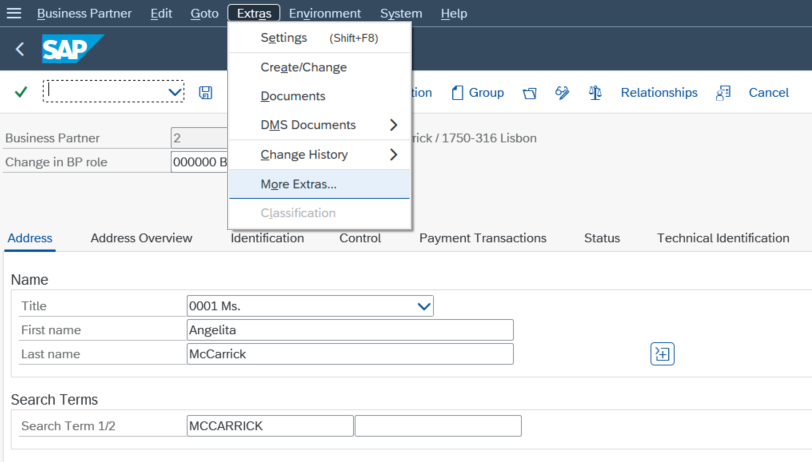
</p>

<p>
  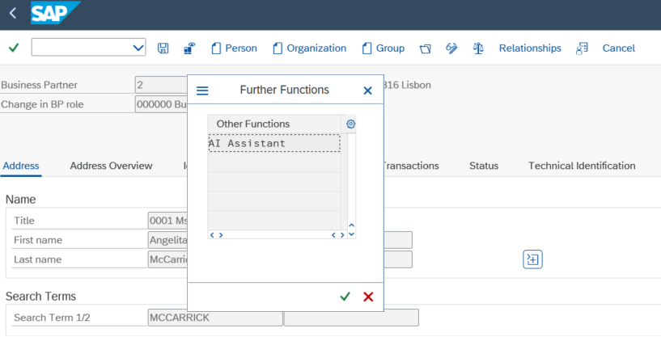
</p>

## Implementing the Instantiation of the Chat User Interface

Let's now implement the instantiation of the chat user interface through which users will interact with the AI Assistant.

For now, we will implement only the minimum code required to display the chat. Later, we will provide system instructions and tools to the AI Assistant.

```abap
FUNCTION Z_F_EVENT_FCODE_YAAI
  IMPORTING
    VALUE(I_FCODE) LIKE TBZ4-FCODE OPTIONAL
    VALUE(I_CRSFIELD) LIKE BUS000TBFL-TBFLD OPTIONAL
    VALUE(I_CRSLINE) LIKE SY-LILLI OPTIONAL
  EXPORTING
    VALUE(E_XHANDLE) TYPE C.


  e_xhandle = 'X'.

  IF i_fcode <> 'YAAI'.

    CLEAR e_xhandle.

    RETURN.

  ENDIF.

  IF o_chat IS BOUND.

    o_chat->display( ).

    RETURN.

  ENDIF.

  DATA(lo_openai) = NEW ycl_aai_openai( ).

  o_chat = NEW #( io_api = lo_openai
                  i_greeting = 'How can I help you today?' ).

  o_chat->display( ).

ENDFUNCTION.
```

Now that the instantiation is implemented, clicking the `AI Assistant` in the **Extras → More Extras** menu should display the AI Assistant Chat on the right side of the screen, as illustrated in the following screenshot.

<p>
  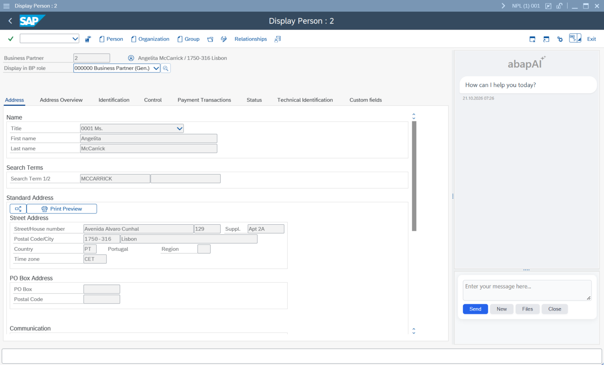
</p>

At this point, the AI Assistant would be able to help users by answering their questions, but it would not have instructions or context beyond what the user might provide.

## Implementing the Tools
Interacting with an LLM (Large Language Model) directly within an SAP transaction is useful, but we can achieve much more. By providing tools, we can enable the LLM to interact directly with the system, access contextual information, and perform actions on behalf of the user. 

For this example, we will keep the implementation simple by creating tools that allow the AI Assistant to retrieve information about the current context of the BP transaction. Specifically, the context will include the validation messages displayed to the user when they attempt to save changes, as well as some basic information about the Business Partner being edited.

### BP Transaction Context

To provide contextual information to the AI Assistant, we need to collect and store it in memory. For this example, we will create a class named `ZCL_BP_CONTEXT` to store the context using static attributes. This will allow us to retrieve this information later using the tools that we will create.

Create a class named `ZCL_BP_CONTEXT` with the following code:

```abap
CLASS zcl_bp_context DEFINITION
  PUBLIC
  FINAL
  CREATE PUBLIC .

  PUBLIC SECTION.

    CONSTANTS mc_msgid TYPE bapiret2-id VALUE 'ZBP' ##NO_TEXT.

    CLASS-DATA: mt_messages TYPE bapiret2_t READ-ONLY.

    CLASS-DATA: ms_but000  TYPE but000 READ-ONLY,
                ms_address TYPE bapibus1006_address READ-ONLY.

    CLASS-METHODS set_data
      IMPORTING
        i_s_but000  TYPE but000 OPTIONAL
        i_s_address TYPE bapibus1006_address OPTIONAL.

    CLASS-METHODS add_message
      IMPORTING
        i_s_msg TYPE bapiret2.

    CLASS-METHODS add_messages
      IMPORTING
        i_t_msg TYPE bapiret2_t.

    CLASS-METHODS reset.

  PROTECTED SECTION.
  PRIVATE SECTION.
ENDCLASS.


CLASS zcl_bp_context IMPLEMENTATION.

  METHOD set_data.

    IF i_s_but000 IS SUPPLIED.
      ms_but000 = i_s_but000.
    ENDIF.

    IF i_s_address IS SUPPLIED.
      ms_address = i_s_address.
    ENDIF.

  ENDMETHOD.

  METHOD add_message.

    IF i_s_msg-number IS INITIAL.
      RETURN.
    ENDIF.

    DATA(ls_msg) = i_s_msg.

    IF ls_msg-id IS INITIAL.
      ls_msg-id = mc_msgid.
    ENDIF.

    IF ls_msg-type IS INITIAL.
      ls_msg-type = 'E' ##NO_TEXT.
    ENDIF.

    " If it is a SAP standard error message, then we need to discard all other messages
    " because the system doesn't call all BAdIs when standard validations fail, and
    " consequently, we are not able to update the context accordingly.
    IF ls_msg-type = 'E' AND ls_msg-id(1) <> 'Z' .

      FREE mt_messages.

      APPEND ls_msg TO mt_messages.

    ELSE.

      READ TABLE mt_messages TRANSPORTING NO FIELDS
        WITH KEY
          id = ls_msg-id
          type = ls_msg-type
          number = ls_msg-number
          message_v1 = ls_msg-message_v1
          message_v2 = ls_msg-message_v2
          message_v3 = ls_msg-message_v3
          message_v4 = ls_msg-message_v4.

      IF sy-subrc <> 0.
        APPEND ls_msg TO mt_messages.
      ENDIF.

    ENDIF.

  ENDMETHOD.

  METHOD add_messages.

    " Discard messages from previous check
    IF i_t_msg IS NOT INITIAL AND i_t_msg[ 1 ]-parameter IS NOT INITIAL.

      DELETE mt_messages WHERE parameter = i_t_msg[ 1 ]-parameter.

    ENDIF.

    LOOP AT i_t_msg ASSIGNING FIELD-SYMBOL(<ls_message>).

      add_message( <ls_message> ).

    ENDLOOP.

  ENDMETHOD.

  METHOD reset.

    FREE mt_messages.

    CLEAR: ms_but000,
           ms_address.

  ENDMETHOD.

ENDCLASS.
```

### BP Transaction Context Tools

Now that we have the class that will hold the contextual information in memory, let's implement the tools that will provide it to the AI Assistant.

Create a class named `ZCL_BP_CONTEXT_TOOLS` with the following code:

```abap
CLASS zcl_bp_context_tools DEFINITION
  PUBLIC
  FINAL
  CREATE PUBLIC .

  PUBLIC SECTION.

    METHODS get_bp_basic_info
      RETURNING VALUE(r_response) TYPE string.

    METHODS get_messages
      RETURNING VALUE(r_response) TYPE string.

  PROTECTED SECTION.

  PRIVATE SECTION.

ENDCLASS.


CLASS zcl_bp_context_tools IMPLEMENTATION.

  METHOD get_bp_basic_info.

    r_response = space.

    IF zcl_bp_context=>ms_but000 IS INITIAL.

      r_response = |No information available. Instruct the user to execute the check on the BP transaction|.
      r_response = |{ r_response } using either the Check button or the F8 key.|.

      RETURN.

    ENDIF.

    r_response = |Partner: { zcl_bp_context=>ms_but000-partner ALPHA = OUT }|.
    r_response = |{ r_response }{ cl_abap_char_utilities=>newline }First Name: { zcl_bp_context=>ms_but000-name_first }|.
    r_response = |{ r_response }{ cl_abap_char_utilities=>newline }Last Name: { zcl_bp_context=>ms_but000-name_last }|.

    IF zcl_bp_context=>ms_address IS NOT INITIAL.

      r_response = |{ r_response }{ cl_abap_char_utilities=>newline }BP Address|.
      r_response = |{ r_response }{ cl_abap_char_utilities=>newline }Street: { zcl_bp_context=>ms_address-street }|.
      r_response = |{ r_response }{ cl_abap_char_utilities=>newline }Number: { zcl_bp_context=>ms_address-house_no }|.
      r_response = |{ r_response }{ cl_abap_char_utilities=>newline }City: { zcl_bp_context=>ms_address-city }|.
      r_response = |{ r_response }{ cl_abap_char_utilities=>newline }Postal Code: { zcl_bp_context=>ms_address-postl_cod1 }|.
      r_response = |{ r_response }{ cl_abap_char_utilities=>newline }Country: { zcl_bp_context=>ms_address-country }|.

    ENDIF.

  ENDMETHOD.

  METHOD get_messages.

    FREE r_response.

    LOOP AT zcl_bp_context=>mt_messages ASSIGNING FIELD-SYMBOL(<ls_message>).

      MESSAGE ID <ls_message>-id
                TYPE <ls_message>-type
                NUMBER <ls_message>-number
                WITH <ls_message>-message_v1
                     <ls_message>-message_v2
                     <ls_message>-message_v3
                     <ls_message>-message_v4
                INTO DATA(l_message_text).

      IF r_response IS INITIAL.

        r_response = |Messages:{ cl_abap_char_utilities=>newline }Type: '{ <ls_message>-type }' Text: { l_message_text }|.

      ELSE.

        r_response = |{ r_response }{ cl_abap_char_utilities=>newline }Type: '{ <ls_message>-type }' Text: { l_message_text }|.

      ENDIF.

    ENDLOOP.

  ENDMETHOD.

ENDCLASS.
```

## Collecting the Contextual Information in the BP Transaction

To collect contextual information from the BP transaction, we will implement the BAdIs `BUPA_ADDR_CHECK` and `BUPA_FURTHER_CHECKS`. Within the `BUPA_ADDR_CHECK` BAdI, we will implement validations and store the resulting messages in the BP context class `ZCL_BP_CONTEXT`. Additionally, we will store BP information in the context class within both BAdIs.

Implement the BAdIs and add the following code to their methods.

BAdI **BUPA_ADDR_CHECK**

**Note**: For the postal code validation used in this BAdI, it is necessary to have the postal code field length correctly set in transaction OY17.

<p>
  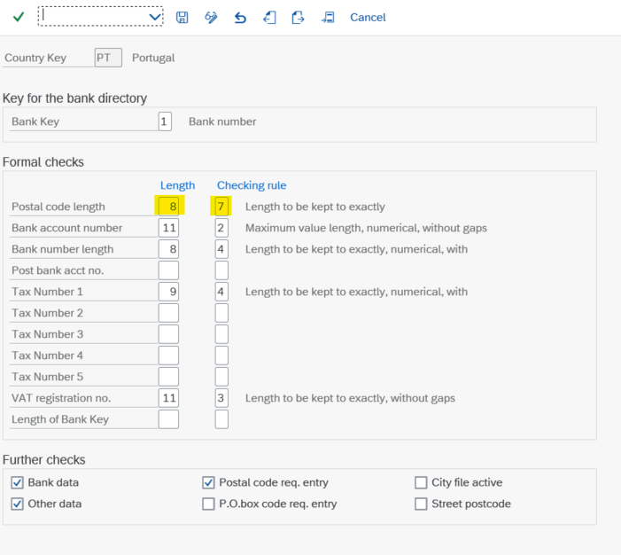
</p>

```abap
CLASS zcl_im_bupa_addr_check DEFINITION
  PUBLIC
  FINAL
  CREATE PUBLIC .

  PUBLIC SECTION.

    INTERFACES if_ex_bupa_addr_check .
  PROTECTED SECTION.
  PRIVATE SECTION.
ENDCLASS.


CLASS zcl_im_bupa_addr_check IMPLEMENTATION.

  METHOD if_ex_bupa_addr_check~check.

    CONSTANTS: lc_msgid     TYPE bapiret2-id VALUE 'ZBP',
               lc_parameter TYPE bapiret2-parameter VALUE 'BUPA_ADDR_CHECK'.

    DATA: l_post_code TYPE string,
          l_city      TYPE string,
          l_prefix    TYPE string.


    IF is_address IS NOT INITIAL.

      " Add BP info to the context
      zcl_bp_context=>set_data(
        EXPORTING
          i_s_address = is_address
      ).

    ENDIF.

    IF is_address-postl_cod1 IS NOT INITIAL AND is_address-country = 'PT'.

      l_post_code = |{ is_address-postl_cod1 }|.
      l_city = to_upper( condense( is_address-city ) ).

      " 1. Validate the postal code format
      IF l_post_code IS INITIAL OR
         strlen( l_post_code ) <> 8 OR
         l_post_code+4(1) <> '-'.

        " The postal code must have the format NNNN-NNN
        APPEND VALUE #( id = lc_msgid
                        number = '001'
                        type = 'E'
                        parameter = lc_parameter ) TO et_return.

      ELSE.

        " Check that the remaining characters are numeric
        DATA(l_digits) = l_post_code(4) && l_post_code+5(3).

        IF NOT l_digits CO '0123456789' OR strlen( condense( l_digits ) ) <> 7.

          " The postal code must contain seven digits
          APPEND VALUE #( id = lc_msgid
                          number = '002'
                          type = 'E'
                          parameter = lc_parameter ) TO et_return.

        ELSE.

          " 2. Extract the first four digits
          l_prefix = l_post_code(4).

          CASE l_city.

            WHEN 'LISBON' OR 'LISBOA'.

              IF l_prefix(1) <> '1'.

                " The postal code prefix is inconsistent with Lisbon
                APPEND VALUE #( id = lc_msgid
                                number = '003'
                                type = 'E'
                                message_v1 = is_address-city
                                parameter = lc_parameter ) TO et_return.


                " test
                APPEND VALUE #( id = lc_msgid
                                number = '001'
                                type = 'E'
                                parameter = lc_parameter ) TO et_return.

                APPEND VALUE #( id = lc_msgid
                                number = '002'
                                type = 'E'
                                parameter = lc_parameter ) TO et_return.

              ENDIF.

            WHEN 'PORTO'.

              IF l_prefix(1) <> '4'.

                " The postal code prefix is inconsistent with Porto
                APPEND VALUE #( id = lc_msgid
                                number = '003'
                                type = 'E'
                                message_v1 = is_address-city
                                parameter = lc_parameter ) TO et_return.

              ENDIF.

            WHEN OTHERS.
              " No city/prefix rule defined for this city

          ENDCASE.

        ENDIF.

      ENDIF.

    ENDIF.

    IF is_address IS NOT INITIAL AND et_return[] IS INITIAL.

      " Personal address data of business partner is error-free.
      APPEND VALUE #( id = lc_msgid
                      number = '004'
                      type = 'S'
                      parameter = lc_parameter ) TO et_return.

    ENDIF.

    " Add messages to the context
    zcl_bp_context=>add_messages( et_return ).

  ENDMETHOD.

ENDCLASS.
```

BAdI **BUPA_FURTHER_CHECKS**

```abap
CLASS zcl_im_bupa_further_checks DEFINITION
  PUBLIC
  FINAL
  CREATE PUBLIC .

  PUBLIC SECTION.

    INTERFACES if_ex_bupa_further_checks.

  PROTECTED SECTION.

  PRIVATE SECTION.

ENDCLASS.


CLASS zcl_im_bupa_further_checks IMPLEMENTATION.


  METHOD if_ex_bupa_further_checks~check_central.

    IF ( sy-msgid IS NOT INITIAL AND
         sy-msgno IS NOT INITIAL AND
         sy-msgty IS NOT INITIAL ) AND
       ( sy-msgid <> 'R11' AND
         sy-msgno <> '555' AND
         sy-msgv1 <> '000000' ).


      zcl_bp_context=>add_messages( VALUE #( ( id = sy-msgid
                                               number = sy-msgno
                                               type = sy-msgty
                                               message_v1 = sy-msgv1
                                               message_v2 = sy-msgv2
                                               message_v3 = sy-msgv3
                                               message_v4 = sy-msgv4
                                               parameter  = sy-tcode ) ) ).

    ENDIF.

    " Add BP basic info to the context
    zcl_bp_context=>set_data(
      EXPORTING
        i_s_but000 = is_but000
    ).


  ENDMETHOD.

ENDCLASS.
```

## Providing System Instructions and Tools to the AI Assistant

Let's now provide our AI Assistant with system instructions and tools.

Edit the function module `Z_F_EVENT_FCODE_YAAI` and update it with the following code.   

```abap
FUNCTION Z_F_EVENT_FCODE_YAAI
  IMPORTING
    VALUE(I_FCODE) LIKE TBZ4-FCODE OPTIONAL
    VALUE(I_CRSFIELD) LIKE BUS000TBFL-TBFLD OPTIONAL
    VALUE(I_CRSLINE) LIKE SY-LILLI OPTIONAL
  EXPORTING
    VALUE(E_XHANDLE) TYPE C.


  e_xhandle = 'X'.

  IF i_fcode <> 'YAAI'.

    CLEAR e_xhandle.

    RETURN.

  ENDIF.

  IF o_chat IS BOUND.

    o_chat->display( ).

    RETURN.

  ENDIF.

  DATA l_instructions TYPE string.

  DATA(l_newline) = cl_abap_char_utilities=>newline.

  l_instructions = |# Role and Purpose{ l_newline }|.

  l_instructions = |{ l_instructions }You are an AI Assistant integrated into the SAP Business Partner (BP) transaction.{ l_newline }|.
  l_instructions = |{ l_instructions }Your primary purpose is to help users understand and work with the BP transaction,{ l_newline }|.
  l_instructions = |{ l_instructions }answer questions related to Business Partner data,{ l_newline }|.
  l_instructions = |{ l_instructions }and provide guidance based on the context of the current transaction.{ l_newline }|.

  l_instructions = |{ l_instructions }You should act as a knowledgeable, practical, and helpful assistant for SAP users.{ l_newline }|.

  l_instructions = |{ l_instructions }# Available Tools and Transaction Context{ l_newline }|.

  l_instructions = |{ l_instructions }You have access to tools that can retrieve information about the current execution{ l_newline }|.
  l_instructions = |{ l_instructions }context of the BP transaction.{ l_newline }|.
  l_instructions = |{ l_instructions }Use these tools whenever the user's question requires information about{ l_newline }|.
  l_instructions = |{ l_instructions }the current transaction or Business Partner.{ l_newline }|.
  l_instructions = |{ l_instructions }Do not assume that you already know the current Business Partner's data or{ l_newline }|.
  l_instructions = |{ l_instructions }the messages generated during transaction execution.{ l_newline }|.
  l_instructions = |{ l_instructions }Retrieve the relevant information through the available tools when necessary.{ l_newline }|.
  l_instructions = |{ l_instructions }Only use information returned by the tools or explicitly provided by the user{ l_newline }|.
  l_instructions = |{ l_instructions }when answering questions about the current transaction context.{ l_newline }|.
  l_instructions = |{ l_instructions }Instruct the user to click the Check button in the BP transaction.|.
  l_instructions = |{ l_instructions }This action is required to update the contextual information used by the tools.{ l_newline }|.

  l_instructions = |{ l_instructions }# Scope{ l_newline }|.

  l_instructions = |{ l_instructions }Focus primarily on questions related to the SAP Business Partner transaction and{ l_newline }|.
  l_instructions = |{ l_instructions }the context made available through your tools.{ l_newline }|.
  l_instructions = |{ l_instructions }If a question is unrelated to this scope, briefly explain your primary purpose and, when appropriate, { l_newline }|.
  l_instructions = |{ l_instructions }help the user formulate a question related to the Business Partner transaction.{ l_newline }|.

  l_instructions = |{ l_instructions }# Communication Style{ l_newline }|.

  l_instructions = |{ l_instructions }Use professional, friendly, and straightforward language.{ l_newline }|.
  l_instructions = |{ l_instructions }When appropriate, provide step-by-step instructions to help users resolve issues or { l_newline }|.
  l_instructions = |{ l_instructions }understand the information displayed in the BP transaction.|.


  DATA(lo_openai) = NEW ycl_aai_openai( ).

  lo_openai->set_system_instructions( l_instructions ).

  DATA(lo_function_calling) = NEW ycl_aai_func_call_openai( ).

  lo_function_calling->add_methods( VALUE #( ( class_name = 'ZCL_BP_CONTEXT_TOOLS'
                                               method_name = 'GET_BP_BASIC_INFO'
                                               description = 'Use this method to retrieve the basic information of the Business Partner being edited/viewed by the user.' )

                                             ( class_name = 'ZCL_BP_CONTEXT_TOOLS'
                                               method_name = 'GET_MESSAGES'
                                               description = 'Use this tool to retrieve the messages displayed to the user in the BP transaction.' ) ) ).

  lo_openai->bind_tools( lo_function_calling ).

  o_chat = NEW #( io_api = lo_openai
                  i_greeting = 'How can I help you today?' ).

  o_chat->display( ).

ENDFUNCTION.
```

At this point, the AI Assistant would be able to answer users' questions, follow the instructions, and retrieve contextual information about the Business Partner being edited in the BP transaction using the provided tools.

Let's test it.

<p>
  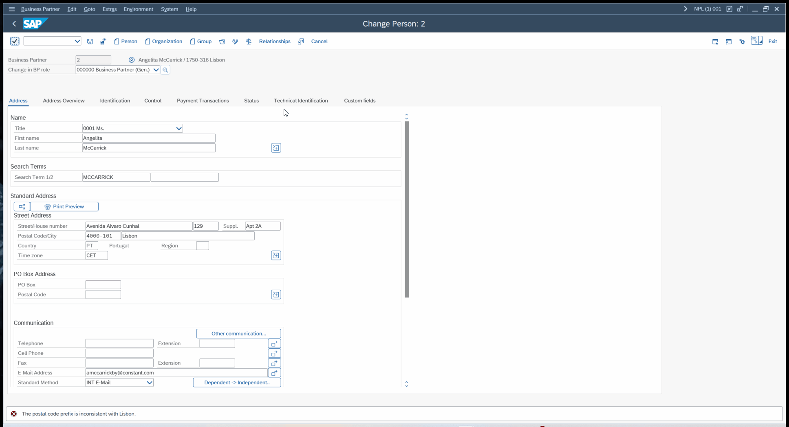
</p>

## What Have We Developed So Far?

Let's stop for a moment and look at how this works under the hood. An image may be worth a thousand words, so let's visualize the architecture in a diagram.

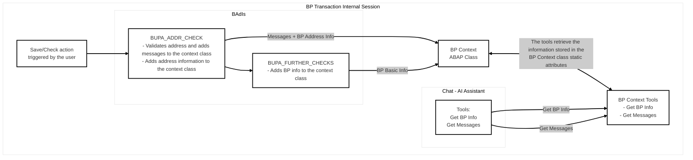

## Equipping the AI Assistant to Perform Actions on the User's Behalf

Let's now create a tool that allows the AI Assistant to make changes to the personal address of the Business Partner being edited in the BP transaction.

Create a class named `ZCL_BUPA_PERSON_ADDRESS_TOOLS` with the following code:

```abap
CLASS zcl_bupa_person_address_tools DEFINITION
  PUBLIC
  FINAL
  CREATE PUBLIC .

  PUBLIC SECTION.

    TYPES: BEGIN OF ty_addr2_data_subset_s,
             street     TYPE addr2_data-street,
             house_num1 TYPE addr2_data-house_num1,
             house_num2 TYPE addr2_data-house_num2,
             city1      TYPE addr2_data-city1,
             post_code1 TYPE addr2_data-post_code1,
             country    TYPE addr2_data-country,
           END OF ty_addr2_data_subset_s.

    METHODS read_bupa_address_from_screen
      RETURNING VALUE(r_response) TYPE string.

    METHODS update_bupa_address_on_screen
      IMPORTING
                i_street          TYPE zst_bupa_address_tool-street
                i_house_num1      TYPE zst_bupa_address_tool-house_num1
                i_house_num2      TYPE zst_bupa_address_tool-house_num2
                i_city            TYPE zst_bupa_address_tool-city
                i_post_code       TYPE zst_bupa_address_tool-post_code
                i_country         TYPE zst_bupa_address_tool-country
      RETURNING VALUE(r_response) TYPE string.

    METHODS read_bupa_address_from_memory
      RETURNING VALUE(r_response) TYPE string.

    METHODS update_bupa_address_in_memory
      IMPORTING
                i_street          TYPE zst_bupa_address_tool-street
                i_house_num1      TYPE zst_bupa_address_tool-house_num1
                i_house_num2      TYPE zst_bupa_address_tool-house_num2
                i_city            TYPE zst_bupa_address_tool-city
                i_post_code       TYPE zst_bupa_address_tool-post_code
                i_country         TYPE zst_bupa_address_tool-country
      RETURNING VALUE(r_response) TYPE string.

  PROTECTED SECTION.

  PRIVATE SECTION.

    METHODS _get_bupa_address_from_memory
      EXPORTING
        e_s_address_value     TYPE addr2_val
        e_s_address_selection TYPE addr2_sel.

ENDCLASS.


CLASS zcl_bupa_person_address_tools IMPLEMENTATION.

  METHOD read_bupa_address_from_memory.

    FREE r_response.

    me->_get_bupa_address_from_memory(
      IMPORTING
        e_s_address_value = DATA(ls_address_personal_value)
    ).

    DATA(ls_bupa_address) = VALUE zst_bupa_address_tool( street      = ls_address_personal_value-street
                                                         house_num1  = ls_address_personal_value-house_num1
                                                         house_num2  = ls_address_personal_value-house_num2
                                                         city        = ls_address_personal_value-city1
                                                         post_code   = ls_address_personal_value-post_code1
                                                         country     = ls_address_personal_value-country ).

    IF ls_bupa_address IS NOT INITIAL.
      r_response = /ui2/cl_json=>serialize( data = ls_bupa_address ).
    ENDIF.

  ENDMETHOD.

  METHOD read_bupa_address_from_screen.

    FREE r_response.

    ASSIGN ('(SAPLSZA7)ADDR2_DATA') TO FIELD-SYMBOL(<addr2_data>).

    IF <addr2_data> IS NOT ASSIGNED OR <addr2_data> IS INITIAL.
      r_response = 'Business Partner address is not available.'.
      RETURN.
    ENDIF.

    DATA(ls_addr2_data_subset) = CORRESPONDING ty_addr2_data_subset_s( <addr2_data> ).

    DATA(ls_bupa_address) = VALUE zst_bupa_address_tool( street     = ls_addr2_data_subset-street
                                                         house_num1 = ls_addr2_data_subset-house_num1
                                                         house_num2 = ls_addr2_data_subset-house_num2
                                                         city       = ls_addr2_data_subset-city1
                                                         post_code  = ls_addr2_data_subset-post_code1
                                                         country    = ls_addr2_data_subset-country ).

    IF ls_bupa_address IS NOT INITIAL.
      r_response = /ui2/cl_json=>serialize( data = ls_bupa_address ).
    ENDIF.

  ENDMETHOD.

  METHOD update_bupa_address_on_screen.

    FREE r_response.

    ASSIGN ('(SAPLSZA7)ADDR2_DATA') TO FIELD-SYMBOL(<addr2_data>).

    IF <addr2_data> IS ASSIGNED.

      DATA(lo_aai_util) = NEW ycl_aai_util( ).

      DATA(ls_addr2_subset) = VALUE ty_addr2_data_subset_s( street = lo_aai_util->replace_unicode_escape_seq( CONV #( i_street ) )
                                                            house_num1 = lo_aai_util->replace_unicode_escape_seq( CONV #( i_house_num1 ) )
                                                            house_num2 = lo_aai_util->replace_unicode_escape_seq( CONV #( i_house_num2 ) )
                                                            city1 = lo_aai_util->replace_unicode_escape_seq( CONV #( i_city ) )
                                                            post_code1 = i_post_code
                                                            country = i_country ).

      <addr2_data> = CORRESPONDING #( ls_addr2_subset ).

    ELSE.
      r_response = 'Error while updating the Business Partner address on screen.'.
    ENDIF.

  ENDMETHOD.

  METHOD update_bupa_address_in_memory.

    DATA ls_address_personal_data TYPE addr2_data.

    FREE r_response.

    me->_get_bupa_address_from_memory(
      IMPORTING
        e_s_address_value = DATA(ls_address_personal_value)
        e_s_address_selection = DATA(ls_address_personal_selection)
    ).

    IF ls_address_personal_value IS INITIAL.
      r_response = 'Business Partner address is not available in memory.'.
      RETURN.
    ENDIF.

    ls_address_personal_data = CORRESPONDING #( ls_address_personal_value ).

    DATA(lo_aai_util) = NEW ycl_aai_util( ).

    ls_address_personal_data-street = lo_aai_util->replace_unicode_escape_seq( CONV #( i_street ) ).
    ls_address_personal_data-house_num1 = lo_aai_util->replace_unicode_escape_seq( CONV #( i_house_num1 ) ).
    ls_address_personal_data-house_num2 = lo_aai_util->replace_unicode_escape_seq( CONV #( i_house_num2 ) ).
    ls_address_personal_data-city1 = lo_aai_util->replace_unicode_escape_seq( CONV #( i_city ) ).
    ls_address_personal_data-post_code1 = i_post_code.
    ls_address_personal_data-country = i_country.

    CALL FUNCTION 'ADDR_PERSONAL_UPDATE'
      EXPORTING
        address_handle             = ls_address_personal_selection-addrhandle
        address_number             = ls_address_personal_selection-addrnumber
        address_personal_data      = ls_address_personal_data
        language                   = sy-langu
        nation                     = ls_address_personal_selection-nation
        person_handle              = ls_address_personal_selection-pershandle
        person_number              = ls_address_personal_selection-persnumber
        check_address              = space
      EXCEPTIONS
        parameter_error            = 1
        personal_address_not_exist = 2
        version_not_exist          = 3
        internal_error             = 4
        OTHERS                     = 99.

    IF sy-subrc = 0.
      r_response = 'Business Partner address was updated.'.
    ELSE.
      r_response = 'Business Partner address update failed.'.
    ENDIF.

  ENDMETHOD.

  METHOD _get_bupa_address_from_memory.

    DATA l_field TYPE string.

    DATA: ls_address_personal_selection TYPE addr2_sel,
          ls_address_personal_value     TYPE addr2_val.

    CLEAR: e_s_address_value,
           e_s_address_selection.

    l_field = '(SAPLSZA7)G_PERSON_NUMBER'.
    ASSIGN (l_field) TO FIELD-SYMBOL(<g_person_number>).

    l_field = '(SAPLSZA7)G_ADDRESS_NUMBER'.
    ASSIGN (l_field) TO FIELD-SYMBOL(<g_address_number>).

    l_field = '(SAPLSZA7)G_PERSON_HANDLE'.
    ASSIGN (l_field) TO FIELD-SYMBOL(<g_person_handle>).

    l_field = '(SAPLSZA7)G_ADDRESS_HANDLE'.
    ASSIGN (l_field) TO FIELD-SYMBOL(<g_address_handle>).

    l_field = '(SAPLSZA7)G_NATION'.
    ASSIGN (l_field) TO FIELD-SYMBOL(<g_nation>).

    l_field = '(SAPLSZA7)G_DATE_FROM'.
    ASSIGN (l_field) TO FIELD-SYMBOL(<g_date_from>).

    IF <g_person_number> IS ASSIGNED.
      ls_address_personal_selection-persnumber = <g_person_number>.
    ENDIF.

    IF <g_address_number> IS ASSIGNED.
      ls_address_personal_selection-addrnumber = <g_address_number>.
    ENDIF.

    IF <g_person_handle> IS ASSIGNED.
      ls_address_personal_selection-pershandle = <g_person_handle>.
    ENDIF.

    IF <g_address_handle> IS ASSIGNED.
      ls_address_personal_selection-addrhandle = <g_address_handle>.
    ENDIF.

    IF <g_nation> IS ASSIGNED.
      ls_address_personal_selection-nation = <g_nation>.
    ENDIF.

    IF <g_date_from> IS ASSIGNED.
      ls_address_personal_selection-date = <g_date_from>.
    ENDIF.

    IF ls_address_personal_selection IS INITIAL.
      RETURN.
    ENDIF.

    CALL FUNCTION 'ADDR_PERSONAL_GET'
      EXPORTING
        address_personal_selection = ls_address_personal_selection
        iv_current_comm_data       = abap_true
      IMPORTING
        address_personal_value     = ls_address_personal_value
      EXCEPTIONS
        parameter_error            = 1
        address_not_exist          = 2
        person_not_exist           = 3
        version_not_exist          = 4
        internal_error             = 5
        OTHERS                     = 6.

    e_s_address_value = ls_address_personal_value.
    e_s_address_selection = ls_address_personal_selection.

  ENDMETHOD.

ENDCLASS.
```

After implementing the tools, edit the function module `Z_F_EVENT_FCODE_YAAI` to add the new tools.

Replace this part of the code: 

```abap
  lo_function_calling->add_methods( VALUE #( ( class_name = 'ZCL_BP_CONTEXT_TOOLS'
                                               method_name = 'GET_BP_BASIC_INFO'
                                               description = 'Use this tool to retrieve the basic information of the Business Partner being edited by the user.' )

                                             ( class_name = 'ZCL_BP_CONTEXT_TOOLS'
                                               method_name = 'GET_MESSAGES'
                                               description = 'Use this tool to retrieve the messages displayed to the user in the BP transaction.' ) ) ).
```

With this:

```abap
  lo_function_calling->add_methods( VALUE #( ( class_name = 'ZCL_BP_CONTEXT_TOOLS'
                                               method_name = 'GET_BP_BASIC_INFO'
                                               description = 'Use this tool to retrieve the basic information of the Business Partner being edited/viewed by the user.' )

                                             ( class_name = 'ZCL_BP_CONTEXT_TOOLS'
                                               method_name = 'GET_MESSAGES'
                                               description = 'Use this tool to retrieve the messages displayed to the user in the BP transaction.' )

                                             ( class_name = 'ZCL_BUPA_PERSON_ADDRESS_TOOLS'
                                               method_name = 'READ_BUPA_ADDRESS_FROM_MEMORY'
                                               description = 'Use this tool to retrieve the personal address data of the Business Partner being edited by the user.' )

                                             ( class_name = 'ZCL_BUPA_PERSON_ADDRESS_TOOLS'
                                               method_name = 'UPDATE_BUPA_ADDRESS_IN_MEMORY'
                                               description = 'Use this tool to update the personal address data of the Business Partner being edited by the user.' ) ) ).
```

With these new tools, the AI Assistant can update the personal address of a Business Partner within the BP transaction. Note that the tool changes **the current address data stored in memory**. This is one of the most useful capabilities of this type of integration: because the tool runs in the same internal session as the SAP transaction, it can access the current data stored in memory, provided, of course, that the transaction allows the data to be referenced or retrieved.

Let's test it.

<p>
  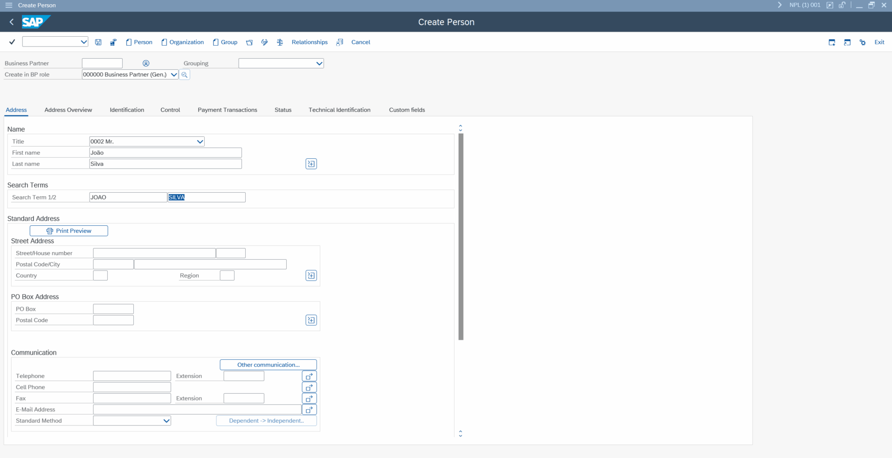
</p>

As you can see, by providing tools, we can extend the AI Assistant’s capabilities and make it more useful to users. Since these tools are implemented in ABAP, we can do virtually anything ABAP can do in this context.

Let’s explore a few more examples of tools.

The class `cl_gui_frontend_services` provides some useful features that we can utilize to extend the AI assistant's capabilities.

- **Screenshot Tool** — The `get_screenshot` method can be used to capture screenshots and send them back to the assistant.
- **Clipboard Tools** — The `clipboard_import` and `clipboard_export` methods allow the assistant to access the user's clipboard, enabling it to read and write clipboard data.

Here is the class that implements these tools. 

```abap
CLASS ycl_aai_gui_tools DEFINITION
  PUBLIC
  FINAL
  CREATE PUBLIC .

  PUBLIC SECTION.

    TYPES ty_row TYPE c LENGTH 262143.

    METHODS get_screenshot
      EXPORTING
                e_t_files         TYPE ytt_aai_files
      RETURNING VALUE(r_response) TYPE string.

    METHODS set_clipboard_data
      IMPORTING
                i_clipboard_data  TYPE string
      RETURNING VALUE(r_response) TYPE string.

    METHODS get_clipboard_data
      RETURNING VALUE(r_response) TYPE string.

  PROTECTED SECTION.
  PRIVATE SECTION.
ENDCLASS.


CLASS ycl_aai_gui_tools IMPLEMENTATION.

  METHOD get_screenshot.

    DATA: l_mime_type      TYPE string,
          l_file_extension TYPE string,
          l_image          TYPE xstring.

    cl_gui_frontend_services=>get_screenshot(
      IMPORTING
        mime_type_str        = l_mime_type
        image                = l_image
      EXCEPTIONS
        access_denied        = 1
        cntl_error           = 2
        error_no_gui         = 3
        not_supported_by_gui = 4
        OTHERS               = 5
    ).

    IF sy-subrc <> 0.

      IF sy-subrc = 1.
        r_response = 'Error: access denied.'.
      ELSE.
        r_response = 'An error occurred while generating screenshot.'.
      ENDIF.

    ELSE.

      r_response = 'Here is the requested screenshot.'.

      SPLIT l_mime_type AT '/' INTO DATA(l_dummy) l_file_extension.

      IF l_file_extension IS NOT INITIAL.
        l_file_extension = condense( '.' && l_file_extension ).
      ENDIF.

      e_t_files = VALUE #( ( content = cl_http_utility=>encode_x_base64( unencoded = l_image )
                             filename = |screenshot{ l_file_extension }|
                             file_size = xstrlen( l_image )
                             file_type = l_mime_type ) ).

    ENDIF.

  ENDMETHOD.

  METHOD get_clipboard_data.

    DATA lt_data TYPE STANDARD TABLE OF ty_row.

    cl_gui_frontend_services=>clipboard_import(
      IMPORTING
        data                 = lt_data
        length               = DATA(l_length)
      EXCEPTIONS
        cntl_error           = 1                " Control error
        error_no_gui         = 2                " No GUI available
        not_supported_by_gui = 3                " GUI does not support this
        OTHERS               = 4
    ).

    IF sy-subrc <> 0.

      r_response = 'Error while importing data from the clipboard.'.

    ELSE.

      IF lt_data IS INITIAL.
        r_response = 'The clipboard is empty.'.
      ENDIF.

      LOOP AT lt_data ASSIGNING FIELD-SYMBOL(<l_row>).

        IF r_response IS INITIAL.
          r_response = <l_row>.
        ELSE.
          r_response = |{ r_response }{ cl_abap_char_utilities=>newline }{ <l_row> }|.
        ENDIF.

      ENDLOOP.

    ENDIF.

  ENDMETHOD.

  METHOD set_clipboard_data.

    DATA lt_data TYPE STANDARD TABLE OF ty_row.

    DATA l_rc TYPE i.

    SPLIT i_clipboard_data AT cl_abap_char_utilities=>newline INTO TABLE lt_data.

    cl_gui_frontend_services=>clipboard_export(
      IMPORTING
        data                 = lt_data                 " Data
      CHANGING
        rc                   = l_rc                 " Return Code
      EXCEPTIONS
        cntl_error           = 1                " Control error
        error_no_gui         = 2                " No GUI available
        not_supported_by_gui = 3                " GUI does not support this
        no_authority         = 4                " Authorization check failed
        OTHERS               = 5
    ).

    IF sy-subrc <> 0 OR l_rc <> 0.

      r_response = 'Error while exporting data to the clipboard.'.

    ELSE.

      LOOP AT lt_data ASSIGNING FIELD-SYMBOL(<l_row>).

        IF r_response IS INITIAL.
          r_response = <l_row>.
        ELSE.
          r_response = |{ r_response }{ cl_abap_char_utilities=>newline }{ <l_row> }|.
        ENDIF.

      ENDLOOP.

    ENDIF.

  ENDMETHOD.

ENDCLASS.
```

In case you want to test these tools, edit the function module `Z_F_EVENT_FCODE_YAAI` and update its code by adding them in the `lo_function_calling->add_methods` method call, similarly to what we did when we added the Personal Address tools.

**Other examples of tools you can build:**

- Call a transaction, similar to a drill-down report.
- Perform background tasks.
- Read, write, upload, and download files.
- Send emails.
- ... and certainly many, many more! 🙂


## A System-Wide Entry Point: Adding the AI Assistant to MENUSYST

As discussed in the General Technical Prerequisites section, adding an entry point for the AI Assistant usually means finding a suitable enhancement for each transaction. There is another option: adding an item to the SAP standard system menu, MENUSYST, to provide a common way to launch the Assistant across transactions, without enhancing each transaction’s user interface individually.

I'm generally opposed to modifying SAP standard objects. I would consider it only in very exceptional cases and only when the change poses no risk to the system’s existing functionality. This approach does involve a standard-system change, which may require minor adjustments during upgrades.

The required changes are:

Transaction: `SE41`

Program: `MENUSYST`

Status: `MEN`

<p>
  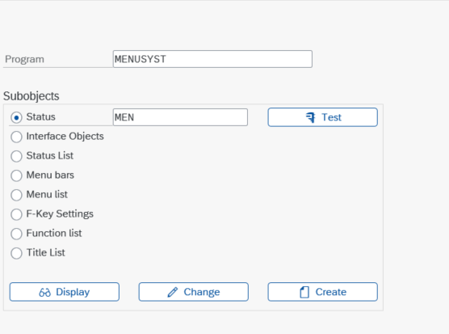
</p>

<p>
  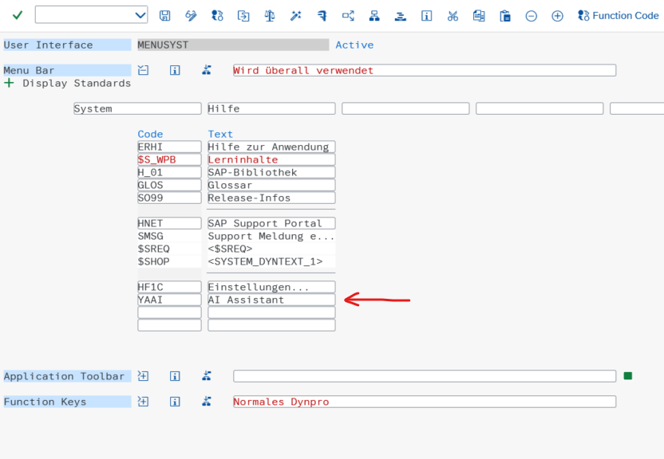
</p>

<p>
  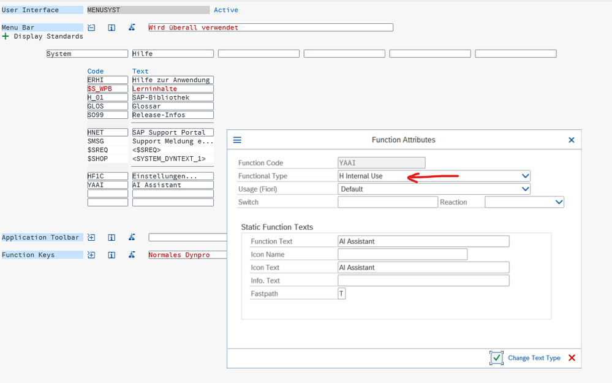
</p>

Transaction: `SE37`

Function Module: `HELP_START`

<p>
  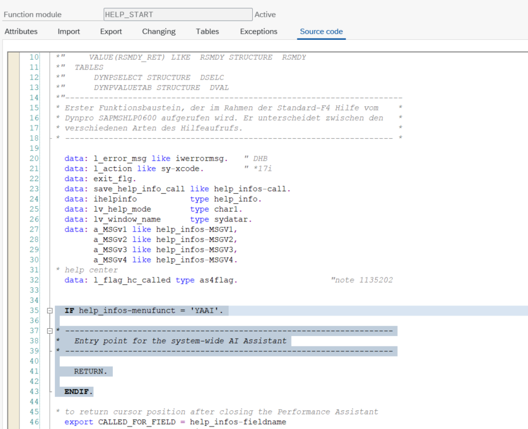
</p>

With this approach, we can provide a system-wide entry point that determines whether the AI Assistant can be launched in the current transaction and, if so, which assistant to instantiate, along with the appropriate system instructions and tools.

## Closing Thoughts

That's it for this article! I hope the ideas and examples shared here give you a good starting point for integrating AI assistants into your SAP system.

There are many ways to approach this, and the right solution will depend on the transactions you want to enhance and the extension options available in your SAP environment.

I'd love to hear about your experiences, what you build, and what you learn along the way.